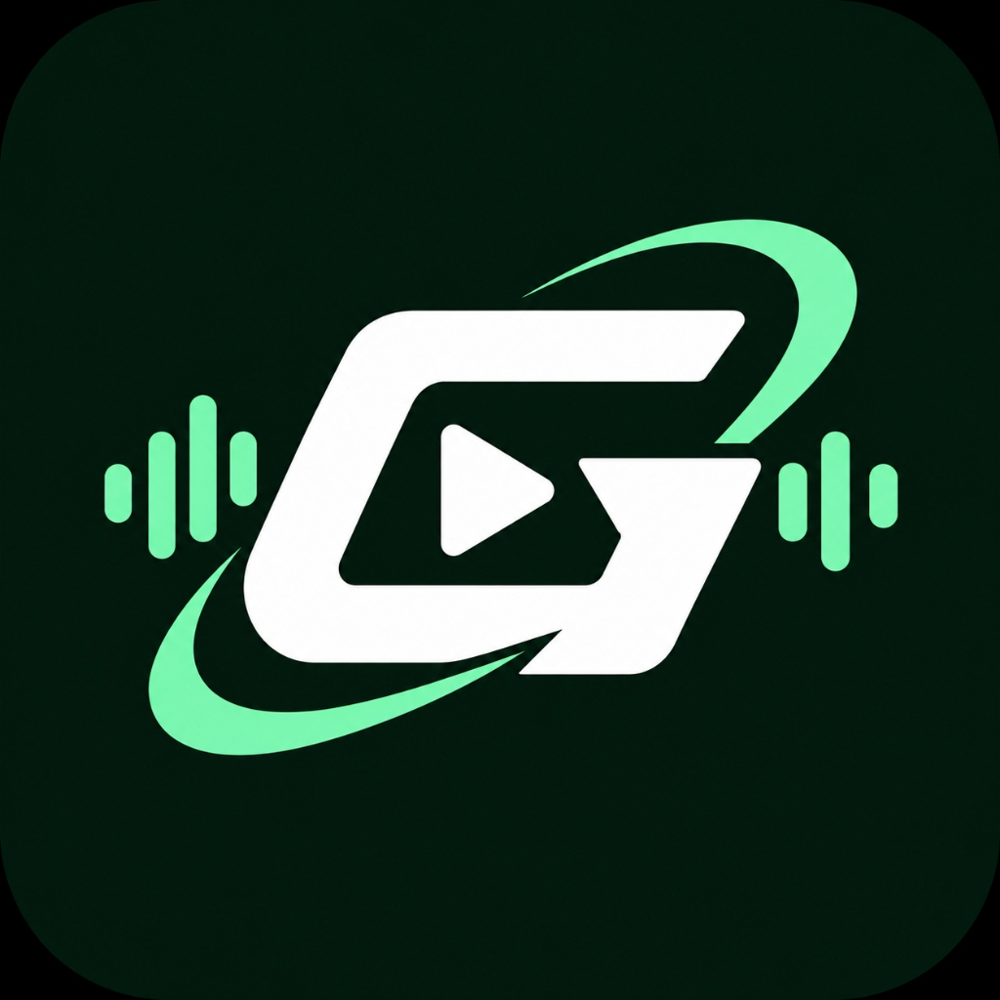

<div align="center">

  

  <h1>GravityTune</h1>

  <p align="center">
    <strong>Redefining the YouTube Music Experience on Web, PWA & Native Android.</strong>
    <br />
    <em>High-performance, privacy-focused, zero ads, background playback, and packed with audiophile features.</em>
  </p>

  <p align="center">
    <a href="https://gravity-tune-three.vercel.app/"><b>🌐 Live Web App</b></a> •
    <a href="https://github.com/DzuI22/Gravity-Tune/releases/download/v2.5.0/GravityTune-v2.5.0.apk"><b>📲 Unduh APK Android (v2.5.0)</b></a> •
    <a href="#features"><b>Features</b></a> •
    <a href="#installation--running"><b>Installation</b></a> •
    <a href="https://github.com/DzuI22/Gravity-Tune/issues"><b>Support & Issues</b></a>
  </p>

  <div align="center">
    
    
    
    
    
    
  </div>

</div>

<hr />

> [!NOTE]
> **GravityTune** adalah aplikasi pemutar YouTube Music mutakhir yang tersedia dalam versi **Web PWA** dan **Native Android App (APK)** mandiri. Dirancang dengan desain modern, privasi total tanpa pelacak, bebas iklan, pemutaran di latar belakang (background play), katalog album artis lengkap, serta sistem pengaturan komprehensif.

---

## 📲 Unduh Aplikasi Android (APK)

Nikmati pengalaman pemutar musik murni tanpa perlu membuka browser!

| Tautan Unduh | Versi | Ukuran | Kompatibilitas |
| :--- | :--- | :--- | :--- |
| **[GravityTune-v2.5.0.apk](https://github.com/DzuI22/Gravity-Tune/releases/download/v2.5.0/GravityTune-v2.5.0.apk)** | `v2.5.0` | ~5.3 MB | Android 7.0 (Nougat) ke atas |

> **Cara Pasang di HP:**
> 1. Unduh berkas APK melalui tautan di atas.
> 2. Buka berkas unduhan di smartphone Anda.
> 3. Jika diminta oleh sistem Android, aktifkan **"Izinkan instalasi dari sumber tidak dikenal"**.
> 4. Tekan **Install** dan buka GravityTune!

---

## ✨ Features Unggulan di v2.5.0

<div align="center" id="features">

<table>
  <tr>
    <td width="50%" valign="top">
      <div align="left">
        <h3>🎵 Playback &amp; Streaming</h3>
        <ul>
          <li><strong>Zero Ads &amp; Background Play:</strong> Pemutaran tanpa gangguan iklan dan tetap bersuara saat layar HP terkunci atau aplikasi diminimalkan.</li>
          <li><strong>Katalog Album Lengkap:</strong> Telusuri seluruh album dan single artis dengan daftar lagu lengkap yang bisa diputar langsung.</li>
          <li><strong>Ultra HD Artwork:</strong> Peningkatan otomatis seluruh thumbnail &amp; cover album menjadi resolusi tinggi 800×800.</li>
          <li><strong>InnerTube Engine:</strong> Akses penuh katalog lagu resmi YouTube Music tanpa limitasi.</li>
          <li><strong>Offline Favorites:</strong> Simpan lagu favorit ke perangkat lokal Anda secara privat.</li>
        </ul>
      </div>
    </td>
    <td width="50%" valign="top">
      <div align="left">
        <h3>🔊 Audio &amp; Performance</h3>
        <ul>
          <li><strong>High-Bitrate Stream:</strong> Ekstraksi audio jernih (Opus / AAC 256kbps).</li>
          <li><strong>Audio Quality Selector:</strong> Pilihan High Quality, Normal, dan Data Saver untuk hemat kuota.</li>
          <li><strong>Crossfade &amp; Gapless:</strong> Transisi pemutaran mulus tanpa hening antar lagu.</li>
          <li><strong>MediaSession API:</strong> Kontrol lagu penuh dari Lockscreen, Dynamic Island, dan tombol headset/Bluetooth.</li>
          <li><strong>Native Android &amp; PWA:</strong> Tersedia sebagai APK mandiri maupun PWA yang sangat responsif.</li>
        </ul>
      </div>
    </td>
  </tr>
  <tr>
    <td width="50%" valign="top">
      <div align="left">
        <h3>🎤 Live Lyrics &amp; Discovery</h3>
        <ul>
          <li><strong>Real-time Karaoke Lyrics:</strong> Sinkronisasi lirik kata per kata dengan efek blur fokus interaktif via LRCLIB &amp; YouTube Captions.</li>
          <li><strong>Curated Artist Showcase:</strong> Barisan foto asli resolusi tinggi dari musisi Indonesia, Internasional, dan K-Pop.</li>
          <li><strong>Fixed Search Engine:</strong> Pengetikan dan penghapusan kata kunci lancar dengan tombol clear instan.</li>
          <li><strong>Listening Stats:</strong> Pantau lagu dan artis yang paling sering Anda dengarkan.</li>
        </ul>
      </div>
    </td>
    <td width="50%" valign="top">
      <div align="left">
        <h3>🎨 Interface &amp; Customization</h3>
        <ul>
          <li><strong>3 Dedicated Player Modes:</strong> Full Player Bar, Live Karaoke Lyrics, dan Active Queue Sheet.</li>
          <li><strong>Full 17 Settings Suite:</strong> Tema OLED murni, warna dinamis, manajemen cache, backup/restore data JSON, hingga opsi developer.</li>
          <li><strong>Dynamic Ambient Glow:</strong> Warna latar yang beradaptasi lembut mengikuti warna sampul lagu.</li>
          <li><strong>Android Solid Dock:</strong> Desain MiniPlayer dan navigasi bawah yang solid tanpa tabrakan teks.</li>
        </ul>
      </div>
    </td>
  </tr>
</table>

</div>

---

## 📱 UI Modes

GravityTune menghadirkan 3 mode tampilan pemutar musik yang dirancang presisi:

1. **Player Bar Mode:**
   - Menampilkan sampul album berukuran besar dengan sudut membulat modern.
   - Tombol squircle cepat: Share lagu, Tambah ke Favorit (Heart), dan Menu Tambahan.
   - Scrubber durasi presisi dengan waktu berjalan dan total durasi.
   - Kontrol pemutaran: Tombol Shuffle, Lagu Sebelumnya, Big Round Play/Pause, Lagu Selanjutnya, dan Mode Repeat (One/All).
   - Tombol pintasan bawah untuk membuka Queue, Sleep Timer (Moon), dan Lyrics.

2. **Live Lyrics Mode:**
   - Latar belakang gradien radial dinamis yang diambil dari nuansa warna cover album.
   - Header ringkas dengan thumbnail, judul lagu, tombol Close (X), dan More.
   - Tampilan lirik karaoke interaktif dengan auto-scroll dan penekanan baris aktif berkedip lembut.
   - Mini scrubber dan kontrol volume langsung dari halaman lirik.

3. **Active Queue Mode:**
   - Panel antrean lengkap dengan info bar jumlah lagu dan estimasi durasi total.
   - Tombol aksi: Acak antrean (Shuffle), Ulangi (Repeat), dan Autoplay Infinity pill.
   - Kartu "Continue Playing" khusus dengan aksen olive-lime untuk lagu yang sedang berputar.
   - Daftar antrean lagu berikutnya yang dapat di-tap langsung untuk melompat ke lagu tersebut.

---

## ⚙️ Full 17 Settings Suite

Halaman pengaturan GravityTune dirancang dengan gaya card group modern beraksen icon hijau lime (`#d1e289`):

- **Appearance:** Pengaturan tema Pure Black OLED, warna dinamis cover, gaya player, dan sudut membulat cover.
- **Playback:** Pilihan kualitas audio (High/Normal/Data Saver), slider crossfade (0-12s), normalisasi audio, dan gapless playback.
- **Lyrics:** Pengaturan auto-scroll karaoke, efek blur, romanisasi teks, dan ukuran font lirik.
- **Content:** Preferensi bahasa katalog dan filter konten eksplisit.
- **Behavior:** Riwayat pencarian, pause saat mute, dan autoplay lagu terkait.
- **Integration:** Koneksi Last.fm Scrobbling dan Discord Rich Presence.
- **AI Integration:** Personalisasi rekomendasi musik cerdas (Gemini / OpenAI API key).
- **Storage:** Meteran penggunaan cache dan tombol satu klik untuk membersihkan cache browser.
- **Backup & Restore:** Ekspor dan impor data favorit serta setelan dalam berkas format `.json`.
- **Developer Options:** Force HD thumbnail mode dan debug stream log.
- **About:** Versi aplikasi (v2.5.0), identitas GravityTune, dan lisensi.

---

## 🚀 Installation & Running

### Cara 1: Unduh Berkas APK Android
Langsung pasang di ponsel pintar Android Anda:
👉 **[Unduh GravityTune-v2.5.0.apk](https://github.com/DzuI22/Gravity-Tune/releases/download/v2.5.0/GravityTune-v2.5.0.apk)**

---

### Cara 2: Akses Web App (Live PWA)
Kunjungi versi web browser yang selalu terhubung:
👉 **[https://gravity-tune-three.vercel.app/](https://gravity-tune-three.vercel.app/)**

---

### Cara 3: Menjalankan di Komputer Lokal (Self-Hosted)

#### Prasyarat:
- [Node.js](https://nodejs.org/) v18 atau lebih baru
- Git

#### Langkah Instalasi:
```bash
# 1. Clone repository
git clone https://github.com/DzuI22/Gravity-Tune.git
cd Gravity-Tune

# 2. Install dependencies
npm install

# 3. Jalankan server pengembangan
npm run dev
```

Buka browser Anda di:
👉 **http://localhost:3000**

---

## 🛠️ Tech Stack & Architecture

- **Core Framework:** [Next.js 14](https://nextjs.org/) (App Router) + React 18
- **Mobile Runtime:** [Capacitor 8](https://capacitorjs.com/) (Android Native Engine)
- **Language:** [TypeScript](https://www.typescriptlang.org/)
- **Styling:** [Tailwind CSS](https://tailwindcss.com/)
- **Icons:** [Lucide React](https://lucide.dev/)
- **CI/CD:** [GitHub Actions](https://github.com/features/actions) (Automated APK Build & Release)
- **Music & Stream Engine:** [YouTube.js (InnerTube)](https://github.com/LuanRT/YouTube.js)
- **Lyrics Provider:** [LRCLIB](https://lrclib.net/) + YouTube Synced Captions
- **Hosting:** [Vercel](https://vercel.com)

---

## ⚖️ Legal Disclaimer

GravityTune adalah klien pemutar musik pihak ketiga independen.
- Tidak berafiliasi dengan Google LLC atau YouTube.
- Seluruh konten audio dan hak cipta musik adalah milik masing-masing artis dan label rekaman resmi.
- Proyek ini dikembangkan untuk tujuan edukasi dan eksplorasi antarmuka pemutar musik modern.

---

## 📄 License

Proyek ini dilisensikan di bawah **MIT License**. Lihat berkas [LICENSE](LICENSE) untuk informasi lebih lanjut.

<div align="center">
  <br />
  <p><b>Dibuat dengan dedikasi untuk penikmat musik di seluruh dunia. Jika kamu menyukai GravityTune, jangan lupa beri ⭐ di GitHub!</b></p>
</div>
